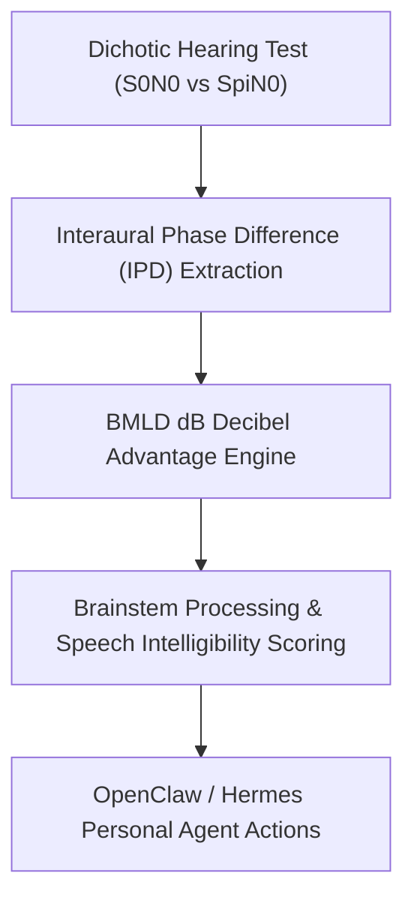

# Auditory Binaural Masking Level Difference (BMLD) Skill

[](LICENSE)
[](https://www.python.org/)
[](requirements.txt)
[](mcp_server.py)
[](SKILL.md)

Zero-dependency sovereign personal agent skill for non-invasive psychoacoustic modeling of Binaural Masking Level Difference (BMLD), brainstem auditory squelch, and cocktail party speech-in-noise intelligibility.



## Features
- **Deterministic Math**: Pure Python standard library implementation with zero external dependencies.
- **Audiological Standard Formulas**: Implements clinically validated homophasic and antiphasic decibel differential modeling.
- **Cocktail Party Intelligibility Modeling**: Direct calculation of speech perception advantage in background noise.
- **Model Context Protocol (MCP)**: Native JSON-RPC tool integration for LLMs and autonomous agents.

## Quickstart

```python
from client import BinauralMaskingLevelDifferenceClient

client = BinauralMaskingLevelDifferenceClient()
result = client.evaluate_bmld(
    s0_n0_threshold_db=64.0,
    spi_n0_threshold_db=50.0,
    test_frequency_hz=500.0
)
print("BMLD:", result["bmld_db"], "dB")
print("Brainstem Score:", result["brainstem_processing_score"])
print("Classification:", result["classification"])
```

## License
Apache-2.0
